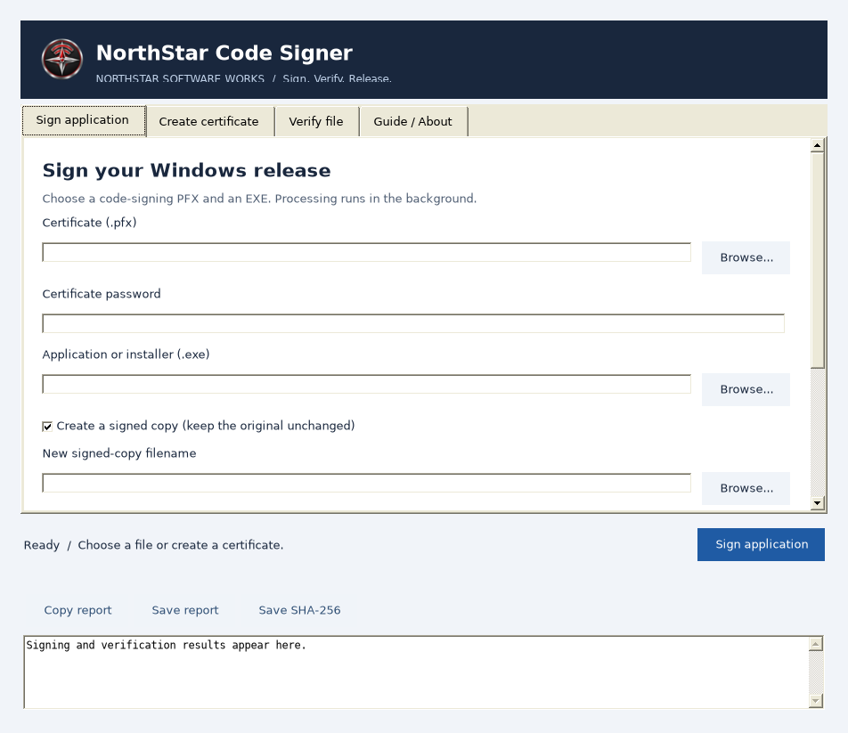

# NorthStar Code Signer 2.0.1

A free Windows desktop utility from **NorthStar Software Works** to create a development certificate, sign an application or setup EXE, verify Windows Authenticode signatures, and export SHA-256 checksums.

**Free and open source · MIT License · No subscription · No account**

_Interface captured using Mono on Linux; native Windows styling differs._

## Features

- Branded, resizable interface with separate Sign, Create, Verify, and Guide screens.
- Scrollable forms for smaller screens and DPI-aware Windows layout.
- Background signing and verification with progress and clear results.
- Password-protected RSA 3072 self-signed certificates, valid for three years.
- SHA-256 signing using an existing exportable code-signing PFX.
- Signed-copy mode enabled by default; optional in-place signing with an original-file backup.
- Optional required Authenticode timestamp; failure leaves the destination uncommitted.
- Independent verification: signer, certificate expiry, Windows status, timestamp authority and file checksum.
- Copy/export result reports and `.sha256.txt` files.
- Embedded branding, helper and MIT license; first-launch license acceptance.
- Windows build scripts, optional per-user Inno Setup installer and GitHub Actions checks.

## 2.0.1 signing correction

Windows PowerShell can report an untrusted self-signed root as `UnknownError`. Version 2.0 rejected that valid development-signing case. This patch checks the native Windows trust result, permits only success or the exact untrusted-root code, and clearly labels the latter `NotTrusted`. Other errors remain failures. Your existing PFX can be reused; no root-store installation is required.

## Start here

1. Extract the complete package to a writable folder.
2. Open **NorthStarCodeSigner.exe** if included in your download, or run **01_build_app.bat** first.
3. Accept the MIT license. Create a certificate on **Create certificate**, or use your existing code-signing PFX.
4. On **Sign application**, select the PFX, enter its password, and choose your EXE.
5. Leave **Create a signed copy** enabled and select a new filename. Click **Sign application**.
6. Inspect the results. Use **Verify file** to check any EXE, and export a checksum/report if desired.

A self-signed certificate does **not** establish public customer trust or guarantee that SmartScreen warnings disappear. `NotTrusted` is an expected result on a PC that does not trust your development certificate. The utility never adds a certificate to Trusted Root or Trusted Publishers.

## Requirements

Windows 10/11, Microsoft .NET Framework 4.8, Windows PowerShell 5.1 and the Windows PKI module. Prefer a supported, patched Windows installation. No Python, virtual environment, Qt, SDK or SignTool is needed. Organizational policy can restrict the worker. Run from a folder you can write to; normal operation needs no administrator elevation.

The included source is C# WinForms, retaining the original app's lightweight architecture. NorthStar's branding, modular source, build/run/check scripts, installer, licensing, documentation, privacy and recovery conventions are supplied without introducing Python dependencies.

## Timestamping and supported signing

The timestamp field accepts a provider-supplied **http:// legacy Authenticode-compatible endpoint**. This is a Windows PowerShell backend limitation, not an RFC 3161 client. Timestamping is off by default, and a requested timestamp must appear on the staged signature before it is committed. Network or provider errors fail the operation instead of silently publishing an untimestamped result.

Hardware-token certificates, nonexportable keys, cloud signing and RFC 3161-only services require the provider's tools. This utility does not issue a publicly validated certificate. PFX files with multiple signing private keys are rejected rather than choosing a signer silently.

## Build and release

| Script | Purpose |
| --- | --- |
| `01_build_app.bat` | Compile the branded EXE using the Windows .NET Framework compiler |
| `02_run_checks.bat` | Run Windows signing tests and capture interface screenshots |
| `03_build_installer.bat` | Package the existing EXE with Inno Setup 6; build only if no EXE exists |
| `04_run_app.bat` | Open the app; build first if necessary |
| `Build_App.bat` | Noninteractive compiler entry point for CI |
| `Optional_Checks.bat` | Compatibility wrapper for the checks script |

**Build app → sign app → build installer → sign installer → verify → publish.**

Building again replaces the compiled EXE, including any signature you added. The installer script deliberately packages an existing EXE to preserve its signature. The installer includes license acceptance, an optional desktop shortcut, the app icon and user guide. Backups and license preferences remain after uninstall; no private certificates are included.

For GitHub, upload the **contents of this folder** at the repository root, including `.gitignore`, `.github`, `LICENSE` and documentation. Commit source; attach binaries and the installer to a tagged Release. The MIT license already exists, so you do not need GitHub to generate a second license.

## Privacy and file safety

Passwords are not deliberately stored in reports, settings, command lines or password files. They travel over standard input, and password fields are cleared after use. Managed strings may remain in memory until garbage collection. Signing PFXs are loaded without adding them to certificate stores; certificate creation briefly uses the current user's Personal store and attempts cleanup. An interrupted worker can leave a newly created certificate/key there. No root trust is changed.

The EXE is signed in a staging file. Existing signed-copy/PFX outputs are never overwritten. In-place signing copies the original to `%LOCALAPPDATA%\NorthStar Code Signer\Backups` and checks for changes before replacing the EXE. Close applications that rebuild or modify the target during signing. Signing replaces any existing embedded signature; it does not append multiple signatures. Checksum/report exports use `.txt` files and an overwrite prompt.

Timestamp requests and Windows trust/revocation checks can use the network. There is no application telemetry or account service. Never put your PFX, private keys or passwords in GitHub or release ZIPs. The `.gitignore` helps but is not a substitute for reviewing uploads.

## Documentation and validation

- [User guide](docs/USER_GUIDE.md)
- [Architecture](docs/ARCHITECTURE.md)
- [Release checklist](docs/RELEASE_CHECKLIST.md)
- [Changes](CHANGELOG.md)
- [Security reporting](SECURITY.md)
- [License](LICENSE)

Read `docs/Build_Verification.json` for the exact checks performed on this package. Windows signing, provider timestamping and installer execution require Windows verification before labeling a GitHub release production-ready.
